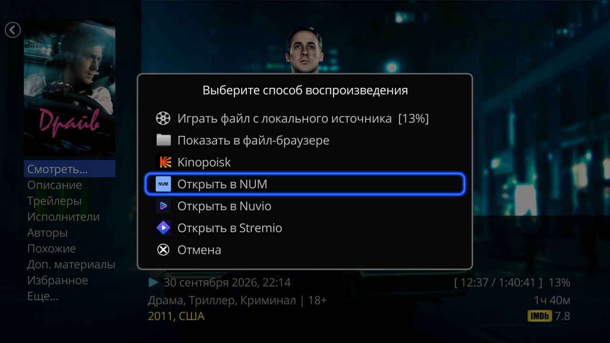
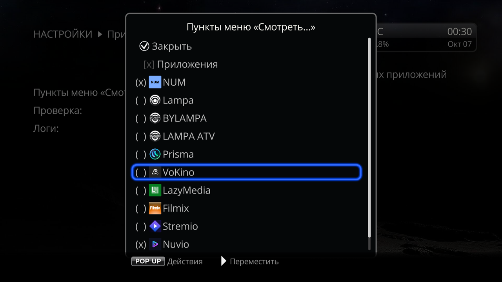

# Play in apps for Dune HD

[Русский](README.md) | **English**

> Android-based Dune HD models only. The plugin will not work on older non-Android models (Sigma chips): they have no Android apps.

The plugin adds items of other apps to the **Play...** menu of a movie or series card (the Dune **Movies** catalog). Pick an item, and the app opens the same title, or, if it cannot open titles by ID, its own search by title. An item appears only for an installed app; the ones you don't need can be hidden.

 

Supported: NUM, Lampa, BYLAMPA, LAMPA ATV, Prisma, VoKino, LazyMedia Deluxe, Stremio, Nuvio TV, FreeZona, ALPAC, Flux, SeasonHit, the Filmix_API and Bazinga Dune plugins, and IPTV Channel Editor plugins with movies (for example, Mir Kino). How each item opens a title, which apps are missing and why — in the [apps reference](plugin/play_in_apps/docs/apps.en.md).

## Install
Download `dune_plugin_play_in_apps_<version>.zip` from [Releases](https://github.com/a1d4r/dune-hd-open-in/releases/latest) and install it on the Dune through **Sources**. Step by step, plus updating, setup and common problems — in the [plugin README](plugin/play_in_apps/README.en.md).

## Build from source
`sh build.sh play_in_apps` runs shellcheck and the tests and builds `dist/dune_plugin_play_in_apps_<version>.zip`. Needs `shellcheck`, `dash`, `zip`, `python3` and `php` (`PHP=…` for another path); `mksh`, if installed, is used for a second test run. The Dune runs PHP 5.3.6: `tests/php53/Dockerfile` builds it along with all the tools needed, `docker build -t dune-php53 tests/php53`, then `docker run --rm -u "$(id -u):$(id -g)" -v "$PWD:/w" -w /w dune-php53 sh build.sh play_in_apps`. The zips in Releases are built by GitHub Actions with the same script in this image; CI runs the tests in the same image, and the logs page also under a real `php-cgi` (the image has none): `CGI_ONLY=1 dash tests/play_in_apps_test.sh`.

## Feedback
Made for my own Dune and shared as is. Report bugs in [Issues](https://github.com/a1d4r/dune-hd-open-in/issues); fixes are best effort.

MIT license, see [LICENSE](LICENSE).
