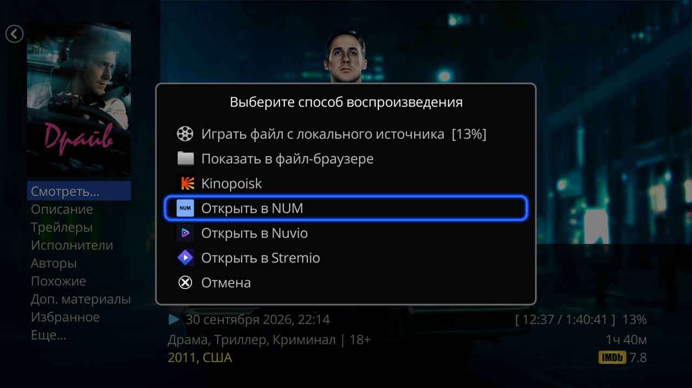
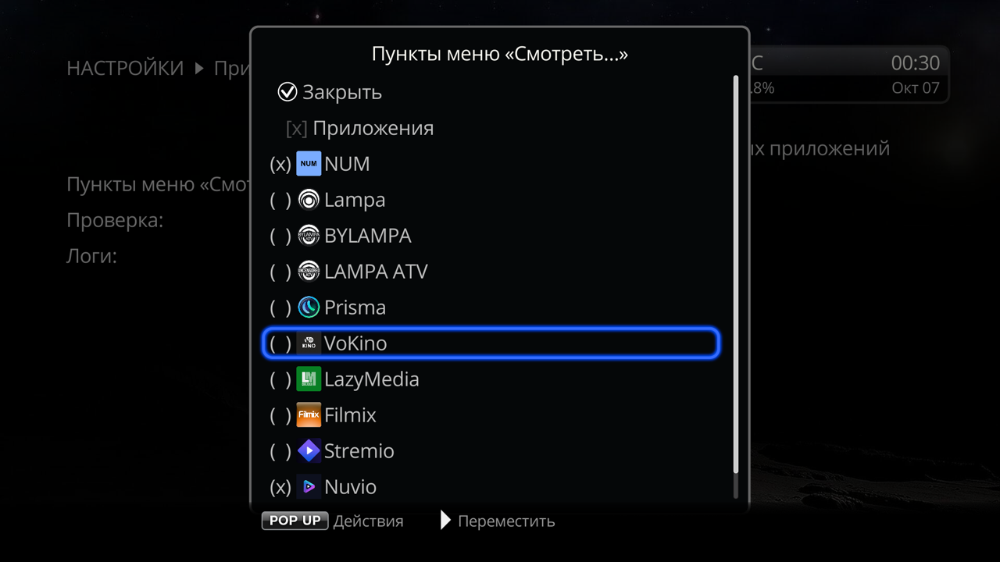

# «Смотреть в приложениях» для Dune HD

**Русский** | [English](README.en.md)

> Только для Android-моделей Dune HD. На старых моделях без Android (на чипах Sigma) плагин работать не будет: в них нет Android-приложений.

Плагин добавляет в меню **«Смотреть…»** карточки фильма или сериала (каталог «Фильмы» Дюны) пункты других приложений. Выбираете пункт — приложение открывает этот же фильм, а если не умеет открывать по ID, то его поиск по названию. Пункт появляется только для установленного приложения; лишние можно скрыть.

 

Поддерживаются: NUM, Lampa, BYLAMPA, LAMPA ATV, Prisma, VoKino, LazyMedia Deluxe, Stremio, Nuvio TV, FreeZona, ALPAC, Flux, SeasonHit, плагины Дюны Filmix_API и Bazinga, а также плагины IPTV Channel Editor с фильмами (например, Mir Kino). Как открывает фильм каждый пункт и каких приложений нет и почему — в [справочнике приложений](plugin/play_in_apps/docs/apps.md).

## Установка
Скачайте `dune_plugin_play_in_apps_<версия>.zip` из [Releases](https://github.com/a1d4r/dune-hd-open-in/releases/latest) и поставьте его на Дюне через «Источники». Пошагово, а также обновление, настройка и частые проблемы — в [README плагина](plugin/play_in_apps/README.md).

## Сборка из исходников
`sh build.sh play_in_apps` прогоняет shellcheck и тесты и собирает `dist/dune_plugin_play_in_apps_<версия>.zip`. Нужны `shellcheck`, `dash`, `zip`, `python3` и `php` (`PHP=…` — другой путь); `mksh`, если установлен, используется для второго прогона тестов. На Дюне PHP 5.3.6 — его и все нужные инструменты собирает `tests/php53/Dockerfile`: `docker build -t dune-php53 tests/php53`, затем `docker run --rm -u "$(id -u):$(id -g)" -v "$PWD:/w" -w /w dune-php53 sh build.sh play_in_apps`. Zip в Releases собирает GitHub Actions тем же скриптом в этом образе; CI прогоняет тесты в этом же образе, а страницу логов — ещё и с настоящим `php-cgi` (в образе его нет): `CGI_ONLY=1 dash tests/play_in_apps_test.sh`.

## Обратная связь
Сделано для своей Дюны и выложено как есть. Об ошибках пишите в [Issues](https://github.com/a1d4r/dune-hd-open-in/issues); исправления — по возможности.

Лицензия MIT, см. [LICENSE](LICENSE).
