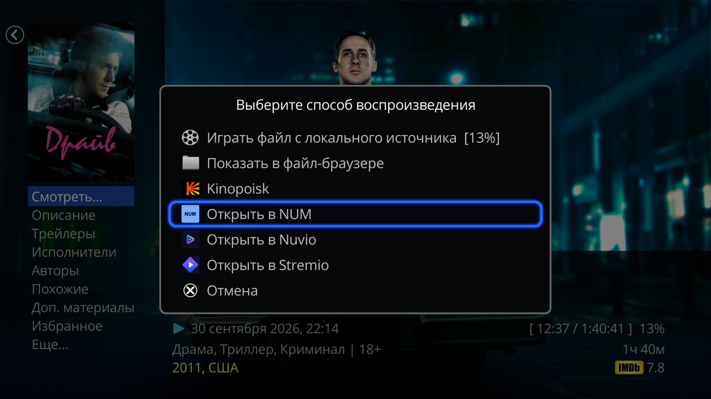
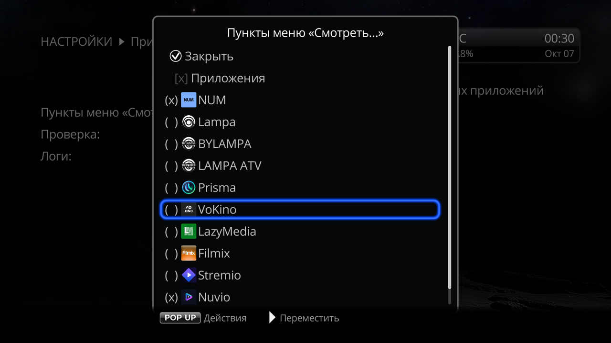

# Play in apps for Dune HD

[Русский](README.md) | **English**

The plugin adds items of other apps to the **Play...** menu of a movie or series card (the Dune **Movies** catalog): NUM, Lampa, Stremio, VoKino and a dozen more. Pick an item, and the app opens the same title, or, if it cannot open titles by ID, its own search by title. Handy when you choose a title in the Dune catalog but watch it in another app.

 

## What you need
- An Android-based Dune HD. The plugin does not work on older non-Android models (Sigma chips): they have no Android apps.
- The apps themselves, installed and set up (accounts, addons, sources). The plugin does not install them and shows an item only for an installed app.

Supported: NUM, Lampa, BYLAMPA, LAMPA ATV, Prisma, VoKino, LazyMedia Deluxe, Stremio, Nuvio TV, FreeZona, ALPAC, Flux, SeasonHit, the Filmix_API and Bazinga Dune plugins, and IPTV Channel Editor plugins with movies (for example, Mir Kino). How each item opens a title and which apps are missing — in the [apps reference](docs/apps.en.md).

## Install
1. If you have the separate "Open in …" plugins (NUM, Lampa, Nuvio and others), uninstall them in the Dune plugin list. This plugin replaces them, and while an old one is installed its item cannot be hidden.
2. Download `dune_plugin_play_in_apps_<version>.zip` from [Releases](https://github.com/a1d4r/dune-hd-open-in/releases/latest) and copy it to a USB drive or to the Dune's internal storage.
3. On the Dune open **Sources**, find the zip and press ENTER.
4. In about half a minute the items appear in the **Play...** menu. No reboot needed.

**Updating.** The Dune finds a new version by itself after it is switched on or rebooted (waking from standby does not count) and offers to install it. If it does not, install the new zip over the old one, as when installing.

**Removing** — in the Dune plugin list. All the plugin's items go away with it.

## How to use
1. Open a movie or series card in **Movies**.
2. Press **Play...** and pick an app.
3. The app opens the title or its search by title. A series opens on its own page: the app does not get the season and episode.
4. How to get back to the Dune card differs from app to app — see the [reference](docs/apps.en.md#how-to-return-to-the-dune).

Items you don't need can be hidden on the plugin screen: **Setup** → **Apps** → **Play in apps** (the same screen is in **Apps** → **Dune HD** and **All**). It also has a check of why an item does not work, and logs for the author. Details — [Plugin screen](docs/screen.en.md).

The plugin itself makes no network requests and runs nothing in the background. The Dune checks for plugin updates on GitHub Pages (`a1d4r.github.io`).

## Common problems
| What happened | What to do |
|---|---|
| The item is not in **Play...** | The app is not installed or the item is hidden. If you have just installed or removed the app, open the plugin screen — the menu updates at once (otherwise after the Dune wakes from standby or reboots). The [check](docs/screen.en.md#check) shows the reason. |
| The item cannot be hidden | It is an item of an old "Open in …" plugin: uninstall that plugin in the Dune plugin list. The plugin screen shows which old plugins are installed. |
| "Failed to start playback" | Right away, without rebooting the Dune, open the [check](docs/screen.en.md#check), then [download the logs](docs/screen.en.md#logs) and send them to the author. |
| The Dune says the card has no ID | This card in the Dune catalog has no ID the app understands (series often have no Kinopoisk ID). Pick an app that searches by title — [table](docs/apps.en.md#how-each-item-opens-a-title). |
| The app opened, but without the title: home screen, empty card, endless loading | The app does not know this title — find it with the app's own search. [What it looks like in each app](docs/apps.en.md#if-the-title-was-not-found). |
| An IPTV provider's plugin shows empty results | Sign in to the provider's account in the plugin itself. If that does not help, open the plugin once and try again. |

## Reference
- [Apps](docs/apps.en.md) — what each item can do, how to return to the Dune, which apps are missing and why.
- [Plugin screen](docs/screen.en.md) — which items to show, check, logs.
- For plugin developers: [how to get your own item in Play...](docs/developers.en.md).

MIT license, see [LICENSE](LICENSE). The QR code is drawn by [qrcode-generator](https://github.com/kazuhikoarase/qrcode-generator) by Kazuhiko Arase (MIT, [qrcode/LICENSE](qrcode/LICENSE)).
