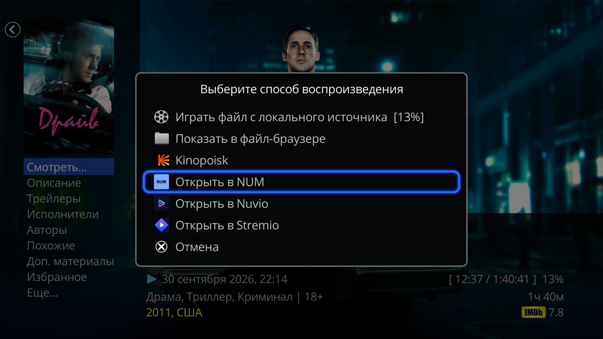
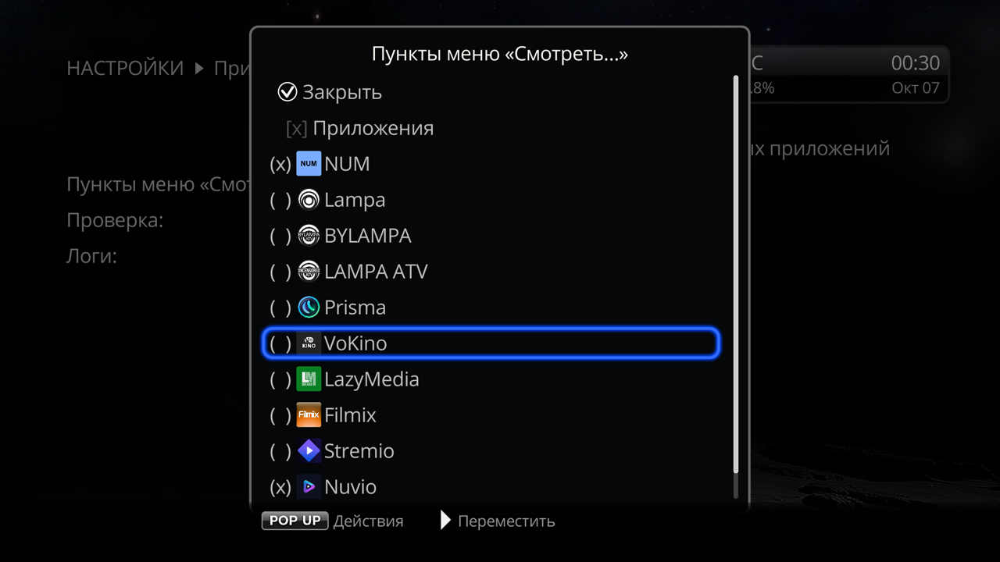

# «Смотреть в приложениях» для Dune HD

**Русский** | [English](README.en.md)

Плагин добавляет в меню **«Смотреть…»** карточки фильма или сериала (каталог «Фильмы» Дюны) пункты других приложений: NUM, Lampa, Stremio, VoKino и ещё десятка. Выбираете пункт — приложение открывает этот же фильм, а если не умеет открывать по ID, то его поиск по названию. Удобно, когда фильм вы выбираете в каталоге Дюны, а смотрите в другом приложении.

 

## Что нужно
- Dune HD на Android. На старых моделях без Android (на чипах Sigma) плагин не работает: там нет Android-приложений.
- Сами приложения, установленные и настроенные (аккаунты, аддоны, источники). Плагин их не ставит, а пункт показывает только для установленного приложения.

Поддерживаются: NUM, Lampa, BYLAMPA, LAMPA ATV, Prisma, VoKino, LazyMedia Deluxe, Stremio, Nuvio TV, FreeZona, ALPAC, Flux, SeasonHit, плагины Дюны Filmix_API и Bazinga, а также плагины IPTV Channel Editor с фильмами (например, Mir Kino). Как открывает фильм каждый пункт и каких приложений нет — в [справочнике приложений](docs/apps.md).

## Установка
1. Если у вас стоят отдельные плагины «Открыть в …» (NUM, Lampa, Nuvio и другие), удалите их в списке плагинов Дюны. Этот плагин их заменяет, а пока старый стоит, его пункт не скрыть.
2. Скачайте `dune_plugin_play_in_apps_<версия>.zip` из [Releases](https://github.com/a1d4r/dune-hd-open-in/releases/latest) и скопируйте на флешку или во внутреннюю память Дюны.
3. На Дюне откройте «Источники», найдите zip и нажмите ENTER.
4. Примерно через полминуты пункты появятся в меню «Смотреть…». Перезагрузка не нужна.

**Обновление.** Новую версию Дюна находит сама после включения или перезагрузки (выход из режима ожидания не считается) и предлагает её поставить. Если не предложила, поставьте новый zip поверх старого, как при установке.

**Удаление** — в списке плагинов Дюны. Вместе с плагином пропадут все его пункты.

## Как пользоваться
1. Откройте в «Фильмах» карточку фильма или сериала.
2. Нажмите «Смотреть…» и выберите приложение.
3. Приложение откроет фильм или поиск по названию. Сериал открывается на своей странице: сезон и серию приложение не получает.
4. Как вернуться в карточку Дюны, у каждого приложения своё — см. [справочник](docs/apps.md#как-вернуться-в-дюну).

Лишние пункты можно скрыть на экране плагина: «Настройки» → «Приложения» → «Смотреть в приложениях» (тот же экран — в «Приложения» → «Dune HD» и «Все»). Там же проверка, почему пункт не работает, и логи для автора. Подробно — [Экран плагина](docs/screen.md).

Сам плагин не ходит в сеть и ничего не запускает в фоне. Обновления плагина Дюна проверяет на GitHub Pages (`a1d4r.github.io`).

## Частые проблемы
| Что случилось | Что делать |
|---|---|
| Пункта нет в «Смотреть…» | Приложение не установлено или пункт скрыт. Если приложение только что поставили или удалили, откройте экран плагина — меню обновится сразу (иначе — после выхода Дюны из режима ожидания или перезагрузки). Причину покажет [проверка](docs/screen.md#проверка). |
| Пункт не скрывается | Это пункт старого плагина «Открыть в …»: удалите его в списке плагинов Дюны. Какие старые плагины стоят, видно на экране плагина. |
| «Не удалось запустить воспроизведение» | Сразу, не перезагружая Дюну, откройте [проверку](docs/screen.md#проверка), затем [скачайте логи](docs/screen.md#логи) и пришлите автору. |
| Дюна пишет, что у карточки нет ID | В каталоге Дюны у этой карточки нет ID, который понимает приложение (у сериалов часто нет ID Кинопоиска). Выберите приложение, которое ищет по названию, — [таблица](docs/apps.md#какой-пункт-как-открывает). |
| Приложение открылось, но без фильма: главный экран, пустая карточка, бесконечная загрузка | Приложение не знает этот фильм — найдите его поиском в самом приложении. [Как это выглядит в каждом](docs/apps.md#если-фильм-не-нашёлся). |
| Плагин IPTV-провайдера показывает пустую выдачу | Войдите в аккаунт провайдера в самом плагине. Не помогло — откройте плагин один раз и повторите. |

## Справочник
- [Приложения](docs/apps.md) — что умеет каждый пункт, как вернуться в Дюну, каких приложений нет и почему.
- [Экран плагина](docs/screen.md) — какие пункты показывать, проверка, логи.
- Для разработчиков плагинов: [как получить свой пункт в «Смотреть…»](docs/developers.md).

Лицензия MIT, см. [LICENSE](LICENSE). QR-код рисует [qrcode-generator](https://github.com/kazuhikoarase/qrcode-generator) Kazuhiko Arase (MIT, [qrcode/LICENSE](qrcode/LICENSE)).
