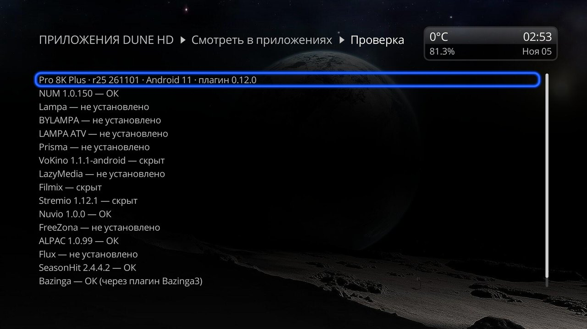
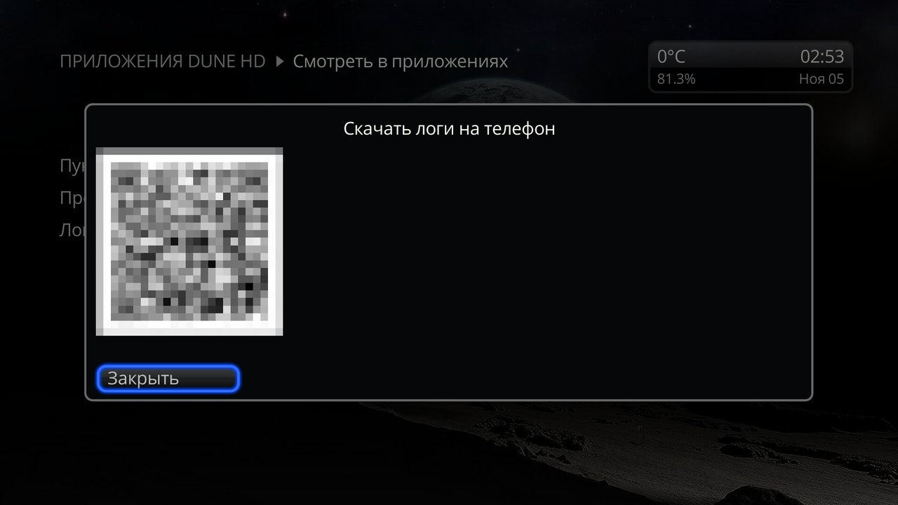
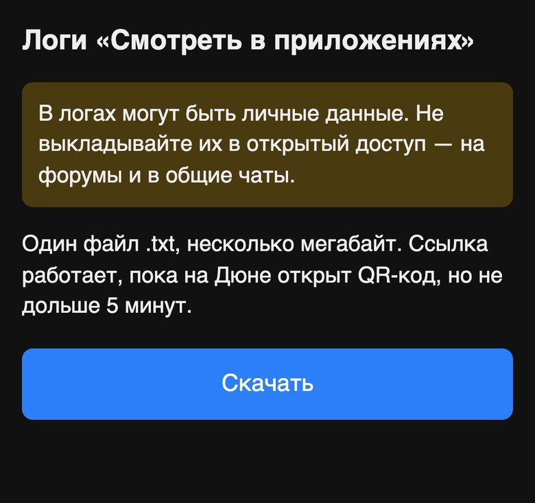

# Plugin screen

[← Back to README](../README.en.md)

To open the screen: **Setup** → **Apps** → **Play in apps**. The same screen is in **Apps** → **Dune HD** and **All**. It has three things: which items to show, the check and the logs.

- Opening the screen is also a way to update the **Play...** menu at once if you have just installed or removed an app or a plugin. Otherwise the menu updates after the Dune wakes from standby or reboots.
- If old "Open in …" plugins are installed, the screen lists them. Uninstall them in the Dune plugin list: while an old plugin is installed, its item cannot be hidden.

## Which items to show
1. Open the setting of the **Play...** menu items — a list of apps with checkmarks opens.
2. Uncheck the items you don't need, check the ones you want. The **Apps** line switches all of them at once; you can uncheck all.
3. Close the list (**Close** or Back). The items leave the menu or come back, and stay so after a reboot and a plugin update.

- To turn everything back on: in the list, POP UP → **Reset to Default Values**.
- Apps that are not installed are in the list too, marked "not installed". The choice for them is kept and applies when the app appears.

## Check
Use it when an item is not in the menu or says "Failed to start playback".

For each item the check looks at whether the app is installed, whether the item is hidden, whether it is in the menu and not another plugin's (for example, an old "Open in …" one), what the item answers for the movie "Cars" and whether the app takes that link. The app itself is not started: Android is only asked which app would open the link.

The result is one screen. The first line is the Dune model, firmware, Android and the plugin version, then one line per item: the app, its version (if installed) and the verdict.

| Verdict | What it means and what to do |
|---|---|
| OK | The item should work. Filmix, Bazinga and IPTV Channel Editor plugins show "OK (through the Dune plugin …)": the item starts a Dune plugin, and the check does not check that launch itself. |
| hidden | You have hidden the item. To bring it back — in the [item setting](#which-items-to-show). |
| not installed | The app is not on the Dune. |
| the item is from another plugin | Another plugin has taken the item, usually an old "Open in …" one. Uninstall it. |
| the item is not in the menu, the item script is missing, the item answers with an error, the app will not take the link | A failure. [Download the logs](#logs) and send them to the author. |
| could not check the launch | It was not possible to find out whether the app takes the link. On models where the Dune runs as an app on Android TV, this may happen to every installed app: Android hides other apps from it. |
| the vod_search entry is turned down | A plugin declared the `vod_search` entry, but with an error, and has no item; the reason is in the same line. This is for that plugin's author: [For plugin developers](developers.en.md). |

What the check does not see: an app that takes too long to open or closes at once shows up only in the logs. The details go there too — the launch command, Android's answer and the Dune's last records about launching items.

## Logs
If an item says "Failed to start playback" or misbehaves, send the logs to the author:
1. **Right after the error, without rebooting the Dune** (a reboot erases part of the logs), open the logs download to a phone on the plugin screen — a QR code appears.
2. Scan it with a phone on the same home network and tap **Download** on the page that opens. One `.txt` file arrives.
3. The link works while the QR code is open on the Dune, at most 5 minutes. **Close** or Back on the remote turns it off at once.

**The logs may contain personal data. Do not post them publicly — on forums or in group chats.**
