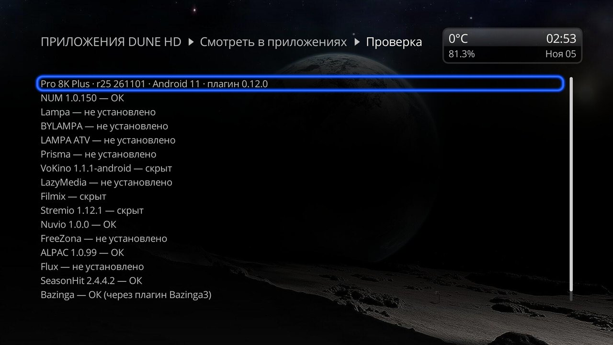
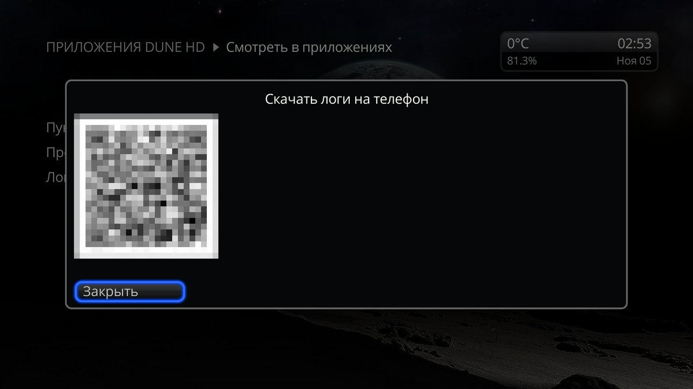
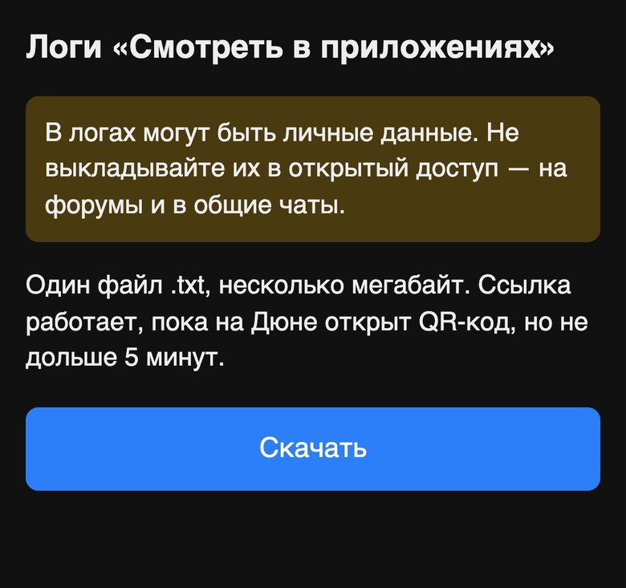

# Экран плагина

[← К README](../README.md)

Экран открывается так: «Настройки» → «Приложения» → «Смотреть в приложениях». Тот же экран есть в «Приложения» → «Dune HD» и «Все». На нём три вещи: какие пункты показывать, проверка и логи.

- Открыть экран — ещё и способ сразу обновить меню «Смотреть…», если вы только что поставили или удалили приложение или плагин. Без этого меню обновится после выхода Дюны из режима ожидания или перезагрузки.
- Если стоят старые плагины «Открыть в …», экран их перечислит. Удалите их в списке плагинов Дюны: пока старый плагин стоит, его пункт не скрыть.

## Какие пункты показывать
1. Откройте настройку пунктов меню «Смотреть…» — откроется список приложений с галочками.
2. Снимите галочку у лишних пунктов, поставьте у нужных. Строка «Приложения» переключает все сразу; можно снять все.
3. Закройте список («Закрыть» или Back). Пункты пропадут из меню или вернутся и останутся такими после перезагрузки и обновления плагина.

- Включить всё обратно: в списке POP UP → «Сброс к значениям по умолчанию».
- Неустановленные приложения тоже есть в списке, с пометкой «не установлено». Выбор для них запомнится и сработает, когда приложение появится.

## Проверка
Нужна, когда пункта нет в меню или он пишет «Не удалось запустить воспроизведение».

Для каждого пункта проверка смотрит: установлено ли приложение, не скрыт ли пункт, есть ли он в меню и не от другого ли плагина (например, от старого «Открыть в …»), что пункт ответит на фильм «Тачки» и примет ли приложение эту ссылку. Само приложение при этом не запускается: Android только спрашивают, какое приложение откроет ссылку.

Результат — один экран. В первой строке — модель Дюны, прошивка, Android и версия плагина, дальше — по строке на пункт: приложение, его версия (если установлено) и итог.

| Итог | Что значит и что делать |
|---|---|
| ОК | Пункт должен работать. У Filmix, Bazinga и плагинов IPTV Channel Editor — «ОК (через плагин …)»: пункт запускает плагин Дюны, и сам запуск проверка не проверяет. |
| скрыт | Вы скрыли пункт. Вернуть — в [настройке пунктов](#какие-пункты-показывать). |
| не установлено | Приложения нет на Дюне. |
| пункт от другого плагина | Пункт занял другой плагин, обычно старый «Открыть в …». Удалите его. |
| пункта нет в меню, нет скрипта пункта, пункт отвечает ошибкой, приложение не примет ссылку | Сбой. [Скачайте логи](#логи) и пришлите автору. |
| не удалось проверить запуск | Не удалось узнать, примет ли приложение ссылку. На моделях, где Дюна стоит приложением на Android TV, так может быть у всех установленных: Android скрывает от неё чужие приложения. |
| вход vod_search не принят | Плагин объявил вход `vod_search`, но с ошибкой, и пункта у него нет; причина — в той же строке. Это для автора того плагина: [Для разработчиков плагинов](developers.md). |

Чего проверка не видит: если приложение открывается слишком долго или сразу закрывается, это видно только в логах. Туда же попадают подробности — команда запуска, ответ Android и последние записи Дюны о запуске пунктов.

## Логи
Если пункт пишет «Не удалось запустить воспроизведение» или ведёт себя странно, пришлите автору логи:
1. **Сразу после ошибки, не перезагружая Дюну** (перезагрузка стирает часть логов), откройте на экране плагина скачивание логов на телефон — появится QR-код.
2. Отсканируйте его телефоном в той же домашней сети и нажмите на открывшейся странице «Скачать». Придёт один файл `.txt`.
3. Ссылка работает, пока на Дюне открыт QR-код, но не дольше 5 минут. «Закрыть» или Back на пульте сразу её гасят.

**В логах могут быть личные данные. Не выкладывайте их в открытый доступ — на форумы и в общие чаты.**
